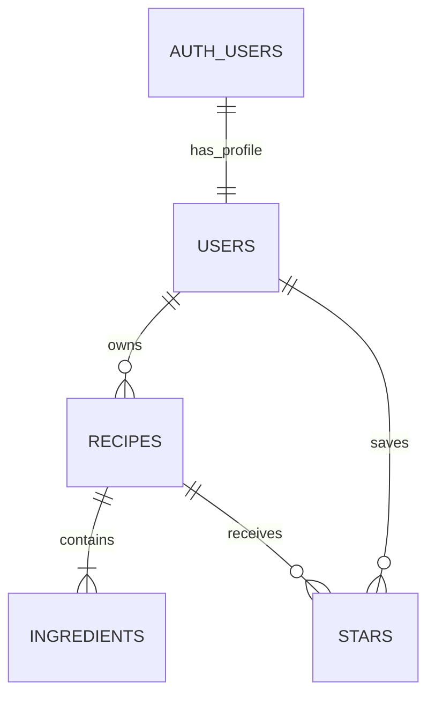

# EasyRecipesCookbook database

The database implements users, recipes, ingredients, and stars from PLAN.md. The SQL sources are `supabase/migrations/20261021000100_core_recipe_model.sql` `supabase/migrations/20261021000200_auth_profiles.sql`, and `supabase/migrations/20261027000100_recipe_management.sql`, and `supabase/migrations/20261027000200_recipe_stars.sql`.

## Relationships

Supabase manages `auth.users`, including authentication credentials. `public.users` holds app profiles. Here, `public` is a database schema name: profiles are private under row-level security.

## users

| Column | PostgreSQL type | Rules |
| --- | --- | --- |
| id | uuid | Primary key; references auth.users.id; account deletion cascades |
| display_name | text | Optional |
| created_at | timestamptz | Required; defaults to current time |

The auth profile migration automatically creates exactly one profile after each auth.users insert and backfills missing profiles for existing accounts. Existing names are preserved. Authenticated clients may read their own profile and update only its display name; browser INSERT permission is removed. Users cannot delete their profile directly; account deletion is handled by the authentication service.

The trigger runs a SECURITY DEFINER function with a fixed empty search_path and fully qualified table names. It is not executable by public, anon, or authenticated clients. It inserts only the account ID, never trusts user metadata for permissions, and lets database failures roll back account creation rather than silently losing the profile. The trigger is installed before the backfill in the same transaction. The primary key and ON CONFLICT prevent duplicates.

## recipes

| Column | PostgreSQL type | Rules |
| --- | --- | --- |
| id | uuid | Primary key; generated automatically |
| user_id | uuid | Required; references users.id; profile deletion cascades |
| title | text | Required; cannot be blank or whitespace-only |
| instructions | text | Required; cannot be blank or whitespace-only |
| servings | integer | Required; greater than zero |
| minutes | integer | Optional; greater than zero when present |
| store | text | Optional store/source label |
| source_url | text | Optional HTTP(S) link with nonempty host and no whitespace |
| rating | integer | Optional; 1–5 |
| created_at | timestamptz | Required; defaults to current time |
| updated_at | timestamptz | Required; refreshed by trigger on recipe updates |

Owners can create, read, edit, and delete recipes. They cannot change ownership, IDs, or timestamps through the client. An index on user_id supports ownership checks and listing. The URL constraint is a basic database guard; full URL parsing and friendly validation belong in the form feature.

## ingredients

| Column | PostgreSQL type | Rules |
| --- | --- | --- |
| id | uuid | Primary key; generated automatically |
| recipe_id | uuid | Required; references recipes.id; recipe deletion cascades |
| name | text | Required; cannot be blank or whitespace-only |
| quantity | numeric | Optional; finite and greater than zero; null means “as needed” |
| unit | text | Required; defaults to “item”; cannot be blank |
| position | integer | Required; defaults to zero; nonnegative display order |

Access depends on ownership of the parent recipe. Both the old and new parent must be owned by the caller when changing recipe_id. An index on (recipe_id, position) supports ingredient lookup and ordering. Positions need not be unique; the UI can use id as a stable tie-breaker.

## stars

| Column | PostgreSQL type | Rules |
| --- | --- | --- |
| user_id | uuid | References users.id; account/profile deletion cascades |
| recipe_id | uuid | References recipes.id; recipe deletion cascades |
| created_at | timestamptz | Required; defaults to current time |

The composite primary key (user_id, recipe_id) prevents duplicate stars and supports user lookups. A separate recipe_id index supports recipe deletion. Users may read, insert, and delete only their own stars for recipes they own. Anonymous clients have no table access. Clients cannot update either key or created_at; star/unstar is insert/delete. The client inserts with ON CONFLICT DO NOTHING for idempotent star requests. Unstarring is an owner-scoped delete. Recipe edits retain stars because the parent recipe ID is unchanged. Stars do not change the numeric recipe rating.

## Security and deletion

All four tables enable row-level security. Anonymous clients have no table access. Authenticated users see only their own rows, even when another user's ID is known. Explicit column grants prevent clients from changing recipe ownership or managed timestamps. Service-role operations are privileged and must remain server-side.

Deleting a recipe deletes its ingredients. Deleting an auth account deletes its profile, recipes, and ingredients. Future tables will add their deletion rules in their own migrations.

## Feature boundaries

### Atomic recipe saves

`public.save_recipe(p_recipe jsonb, p_ingredients jsonb, p_id uuid default null)` returns the saved recipe UUID. Omit `p_id` for creation; supply an owned recipe ID for editing. Recipe JSON contains title, instructions, servings, minutes, store, source_url, and rating. Ingredient JSON is a nonempty array of name, quantity, and unit objects; array order becomes position. Missing quantities become null; missing/blank units default to item. The form requires an explicit unit and initially fills item.

The function derives ownership exclusively from `auth.uid()`, uses SECURITY INVOKER with an empty search_path, and is executable only by authenticated users. Existing RLS and column grants still apply. Unknown and inaccessible recipe IDs both raise “Recipe not found.” It replaces ingredients within the same transaction as the recipe update; validation failures roll back everything, including title and timestamp changes. Ingredient IDs are regenerated on edit. It never accepts ownership changes.

Deferred constraint triggers require at least one ingredient when a recipe insert/update or ingredient removal/move commits. This permits temporary empty ingredients inside the save transaction but rejects incomplete direct writes. Existing empty recipes from before this migration are not automatically changed; they must gain an ingredient when edited. Deleting a recipe or account still cascades normally.

Recipe updates serialize concurrent RPC edits. A BEFORE DELETE/UPDATE ingredient trigger also writes the old parent recipe, serializing direct removals and preventing write skew at repeatable-read isolation. This refreshes the parent’s updated_at timestamp for direct ingredient changes. Conflicting transactions may need retry after a deadlock/serialization error. The local single-connection tests verify constraints and rollback, not concurrent server behavior; validate that separately on development PostgreSQL.

No table columns or ownership policies change in this migration.

Cooking_notes, meal_plan_entries, and grocery_items remain planned. Their migrations will arrive with their features. The original PLAN.md is unchanged.

## Verification

Run `pnpm install --frozen-lockfile` and `pnpm test`. Tests apply the migration to an isolated PGlite database, create two identities, and exercise SQL as the authenticated/anonymous roles. Coverage includes private reads/writes, guessed IDs, forbidden parent changes, validation, timestamps, and cascading deletion.

The test-only auth schema and auth.uid() stand-in simulate identity supplied by Supabase. They do not test token verification, confirmation email, real signup, or the hosted API. The authentication feature includes additional simulated UI and browser tests; the real development-project checks remain pending until Supabase is configured. See README.md for the checklist.
