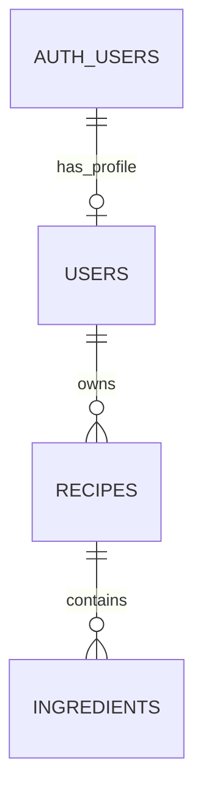

# EasyRecipesCookbook database

This feature defines the first three tables in PLAN.md. The SQL source is `supabase/migrations/20261021000100_core_recipe_model.sql`.

## Relationships

Supabase manages `auth.users`, including authentication credentials. `public.users` holds app profiles. Here, `public` is a database schema name: profiles are private under row-level security.

## users

| Column | PostgreSQL type | Rules |
| --- | --- | --- |
| id | uuid | Primary key; references auth.users.id; account deletion cascades |
| display_name | text | Optional |
| created_at | timestamptz | Required; defaults to current time |

Authenticated users can create/read their own profile and update only its display name. Profile provisioning on signup will be added with the authentication feature. Users cannot delete their profile directly; account deletion is handled by the authentication service.

## recipes

| Column | PostgreSQL type | Rules |
| --- | --- | --- |
| id | uuid | Primary key; generated automatically |
| user_id | uuid | Required; references users.id; profile deletion cascades |
| title | text | Required; cannot be blank or whitespace-only |
| instructions | text | Required; cannot be blank or whitespace-only |
| servings | integer | Required; greater than zero |
| minutes | integer | Optional; greater than zero when present |
| store | text | Optional store/source label |
| source_url | text | Optional HTTP(S) link with nonempty host and no whitespace |
| rating | integer | Optional; 1–5 |
| created_at | timestamptz | Required; defaults to current time |
| updated_at | timestamptz | Required; refreshed by trigger on recipe updates |

Owners can create, read, edit, and delete recipes. They cannot change ownership, IDs, or timestamps through the client. An index on user_id supports ownership checks and listing. The URL constraint is a basic database guard; full URL parsing and friendly validation belong in the form feature.

## ingredients

| Column | PostgreSQL type | Rules |
| --- | --- | --- |
| id | uuid | Primary key; generated automatically |
| recipe_id | uuid | Required; references recipes.id; recipe deletion cascades |
| name | text | Required; cannot be blank or whitespace-only |
| quantity | numeric | Optional; finite and greater than zero; null means “as needed” |
| unit | text | Required; defaults to “item”; cannot be blank |
| position | integer | Required; defaults to zero; nonnegative display order |

Access depends on ownership of the parent recipe. Both the old and new parent must be owned by the caller when changing recipe_id. An index on (recipe_id, position) supports ingredient lookup and ordering. Positions need not be unique; the UI can use id as a stable tie-breaker.

## Security and deletion

All three tables enable row-level security. Anonymous clients have no table access. Authenticated users see only their own rows, even when another user's ID is known. Explicit column grants prevent clients from changing recipe ownership or managed timestamps. Service-role operations are privileged and must remain server-side.

Deleting a recipe deletes its ingredients. Deleting an auth account deletes its profile, recipes, and ingredients. Future tables will add their deletion rules in their own migrations.

## Feature boundaries

The schema permits a recipe to exist while its ingredients are being added. The recipe CRUD feature must save a recipe and at least one ingredient atomically; do not expose an incomplete save flow. That cross-table requirement is not enforced by this migration. Implement the future save with a database function called through one RPC: validate a nonempty ingredient array, insert the recipe and ingredient rows within the same transaction, and roll back the entire operation on any error. Use the caller's identity and ownership policies; do not use separate browser requests for each row.

Stars, cooking_notes, meal_plan_entries, and grocery_items remain planned. Their migrations will arrive with their features. The original PLAN.md is unchanged.

## Verification

Run `pnpm install --frozen-lockfile` and `pnpm test`. Tests apply the migration to an isolated PGlite database, create two identities, and exercise SQL as the authenticated/anonymous roles. Coverage includes private reads/writes, guessed IDs, forbidden parent changes, validation, timestamps, and cascading deletion.

The test-only auth schema and auth.uid() stand-in simulate identity supplied by Supabase. They do not test token verification, confirmation email, real signup, or the hosted API. Verify those against a development Supabase project during the authentication feature.
